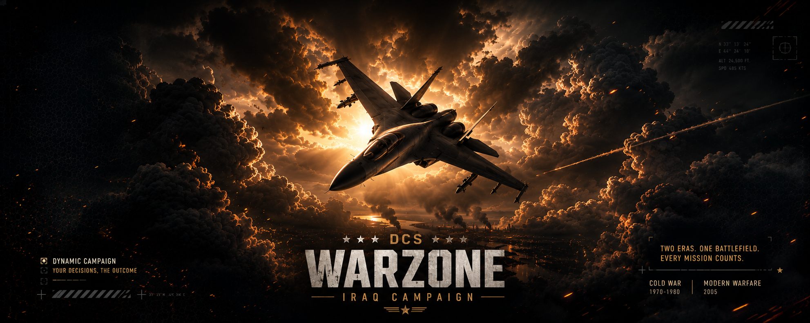

# WarZone Iraq

**DCS World · Iraq · Campagna dinamica Modern · Versione 3.0**  
Creata da **IRON87ITA**.

[Scarica la V3.0](https://github.com/Iron87ita/WarZone-Iraq/releases/download/v3.0/WarZone_IRAQ_IRON87_V3.0.miz) · [Guida F10](F10_GUIDE.md) · [Settori](SECTORS.md) · [English](README.md)

La logica della WarZone Caucaso 4.48, adattata all'Iraq: **nord BLUE, sud RED**, sei settori progressivi e 42 obiettivi terrestri.

Il fronte iniziale è **S3 Qayyarah / Kirkuk**. I BLUE avanzano **S3 → S4 → S5 → S6**, verso Baghdad e Al Kut; i RED avanzano **S3 → S2 → S1**, verso Mosul e Tal Afar. La conquista completa del settore operativo sblocca quello successivo. Le retrovie restano disponibili per l'accesso alle basi; difese, reddito, missioni e cattura attendono lo sblocco.

## Funzioni principali

- Menu **F10 → WARZONE MISSIONS**, con CAP, BARCAP, CAS, SEAD e STRIKE.
- **AI CONTROL** per regolare l'attività della propria IA, chiedere rinforzi e fermare o riprendere le colonne.
- **DYNAMIC AI TASKS** per accettare incarichi contro gruppi nemici appena generati e seguirne la traccia F10.
- Shop personale, cargo fisici, unità terrestri, rifornimenti, EWR e MQ-9/JTAC.
- AWACS, due tanker per coalizione, logistica elicotteri, fanteria e CSAR.
- Persistenza di territori, progressione, portafogli e mezzi acquistati sopravvissuti.
- 55 obiettivi statici originali iracheni, briefing e sei pagine kneeboard.

Gli EWR di entrambi gli schieramenti usano piazzole pianeggianti, lontane dalle piste e senza edifici entro 900 metri. Gli alberi vengono rimossi soltanto nella piazzola scelta, prima dello spawn; gli edifici restano intatti. La regola vale anche per F10 e radar salvati. Se una piazzola non è disponibile, non viene usato un ripiego casuale.

## Installazione

Servono **DCS World**, la mappa **Iraq** e le mod delle unità presenti nella missione, elencate in [INSTALLATION.md](INSTALLATION.md#requirements).

1. Scarica il file `.miz` e copialo in `Saved Games\DCS\Missions\` del tuo profilo DCS.
2. Aprilo in DCS oppure aggiungilo all'elenco missioni del server.
3. Entra in una coalizione e usa **F10 → WARZONE MISSIONS**.

Il salvataggio dedicato resta `Missions\Saves\Modern\WarZone_IRAQ_MODERN_V448_NORTH_BLUE_SOUTH_RED.lua`. Esegui una copia del salvataggio prima di aggiornare una campagna in corso. Il numero V448 è un identificatore interno ereditato; la versione pubblica di questa missione è **3.0**.

La portaerei BLUE nel Golfo resta un supporto separato dal fronte terrestre. Non vengono generate incursioni navali nell'entroterra.

Il pacchetto corrente è la V3.0 fornita da IRON87ITA, pubblicata senza ricostruire o modificare la missione. Restano gli identificatori interni Lua e il percorso dedicato del salvataggio Iraq. Le versioni 1.0 e 2.0 restano disponibili nel repository. Durante questa pubblicazione non sono stati eseguiti test di gioco in DCS. [Crediti](CREDITS.md) · [Checksum](SHA256SUMS.txt).
