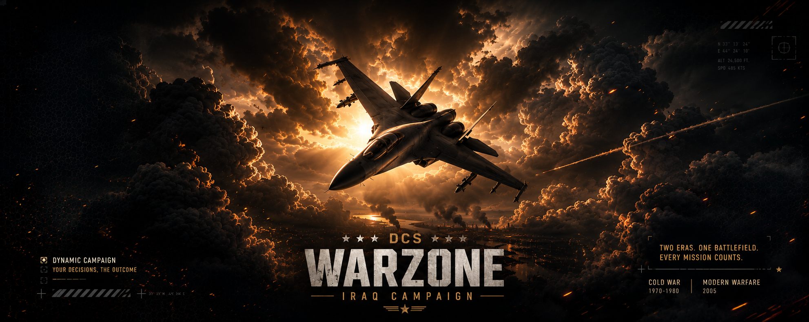

# WarZone Iraq v2.0

**DCS World · Iraq · Modern dynamic sector campaign · IRON87ITA**

The new V2.0 mission package supplied by IRON87ITA is now the current WarZone Iraq download. The `.miz` is uploaded unchanged; publication does not rebuild or modify the mission.

- Mission: `WarZone_IRAQ_IRON87_V2.0_NORTH_BLUE_SOUTH_RED.miz`
- North BLUE / South RED campaign, with six progressive sectors.
- F10 missions, coalition AI controls, logistics and EWR emplacement rules remain documented in the repository guides.
- Updated English and Italian overview, installation download references and package checksums.
- The previous V1.0 package remains available in the repository and its history.

## Installation

Download the `.miz` from the release assets and place it in your DCS Saved Games `Missions` folder, or add it to your dedicated server mission list. Requirements and unit-mod references are listed in [INSTALLATION.md](https://github.com/Iron87ita/WarZone-Iraq/blob/main/INSTALLATION.md).

For an ongoing campaign, stop the mission and back up the existing save before switching packages. The embedded campaign still uses `Missions/Saves/Modern/WarZone_IRAQ_MODERN_V448_NORTH_BLUE_SOUTH_RED.lua`.

## Integrity

SHA-256 of the supplied V2.0 mission:

```text
f4286174de6a8bcc3627f9753660f24228460c56d2a40eb9634b391b121ac7b7
```

No DCS gameplay session or test suite was run for this publication.

## Italiano

Nuovo pacchetto **WarZone Iraq V2.0** fornito da IRON87ITA, pubblicato senza modificare la `.miz`. Scarica la missione dagli allegati della release. Le guide e i collegamenti di download del repository sono aggiornati alla V2.0; banner e storico V1.0 restano disponibili. Prima di cambiare missione in una campagna in corso, ferma la sessione ed esegui una copia del salvataggio.
